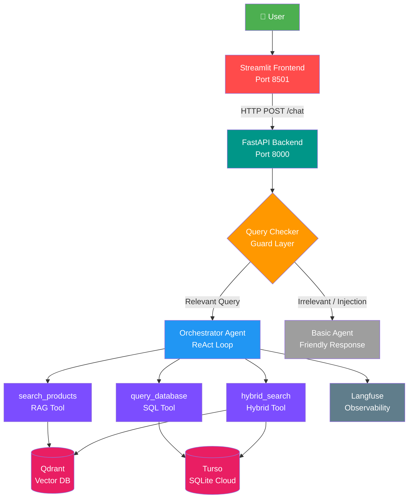
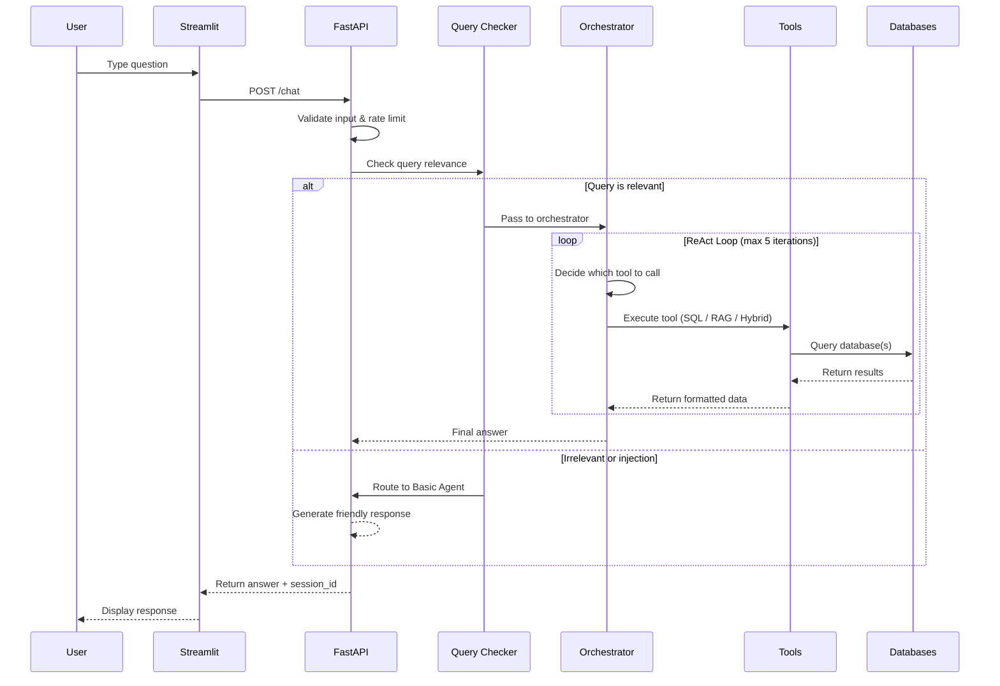

# 🛒 Olist E-commerce AI Assistant


---

> This repository is a revived version of a team capstone built at Purwadhika AI Engineering ([original team repository](https://github.com/Purwadhika-AI-Engineering/Repo-Final-Project-Kelompok-3)). It runs on its own Turso, Qdrant, OpenAI and Langfuse accounts and adds an updated ingest script (`utils/qdrant/ingest.py`), a corrected SQL seed script, cleaned-up requirements, and Docker/compose fixes. See [Team](#team) for credits.

## 🚀 Overview

**Olist E-commerce AI Assistant** is a multi-agent AI chatbot designed for exploring and analyzing the [Olist Brazilian E-commerce](https://www.kaggle.com/datasets/olistbr/brazilian-ecommerce) dataset. It combines **natural language to SQL** query generation, **semantic vector search** via Qdrant, and a **hybrid retrieval** strategy to provide comprehensive, data-driven answers about products, sellers, customers, orders, and reviews.

### Key Capabilities

- **Text-to-SQL**: Converts natural language questions into SQL queries and executes them against a Turso (libSQL) cloud database containing ~100K orders (2016–2018).
- **RAG (Retrieval-Augmented Generation)**: Performs semantic search over product reviews using OpenAI embeddings and Qdrant vector database.
- **Hybrid Search**: Combines SQL-based structured filtering with RAG semantic search for questions that require both data types.
- **Prompt Injection Detection**: Built-in guard layer that detects and blocks prompt injection attempts before they reach the agent.
- **Output Guardrails**: Query relevance checking ensures only e-commerce-related queries are processed by the full agent pipeline.
- **Observability**: Integrated Langfuse tracing for monitoring agent behavior, tool calls, and performance.

### Who Is This For?

Data analysts, product managers, and business stakeholders who want to explore Olist e-commerce data through a natural language conversational interface — no SQL knowledge required.

---

## 🏗️ Architecture



**Flow Summary:**

1. User sends a message via the Streamlit chat interface.
2. The Streamlit frontend forwards the message to the FastAPI backend (`POST /chat`).
3. The **Query Checker** (guard layer) evaluates whether the query is relevant to Olist e-commerce and screens for prompt injection.
4. If relevant → the **Orchestrator Agent** runs a ReAct loop (up to 5 iterations), selecting from three tools: `search_products`, `query_database`, or `hybrid_search`.
5. If irrelevant or injection detected → a **Basic Agent** provides a friendly, scoped response.
6. The final answer is returned to the user through the Streamlit UI.

---

## 🛠️ Tech Stack

| Layer            | Technology                                                        |
| ---------------- | ----------------------------------------------------------------- |
| **Backend API**  | FastAPI 0.115, Uvicorn, Python 3.12                               |
| **Frontend**     | Streamlit 1.39                                                    |
| **LLM**          | OpenAI GPT-4o-mini (general), GPT-5.4-mini (SQL generation)      |
| **Framework**    | LangChain 1.3, LangChain-OpenAI                                  |
| **Vector DB**    | Qdrant (cloud), OpenAI `text-embedding-3-small` embeddings        |
| **SQL Database** | Turso (libSQL cloud SQLite), SQLAlchemy, sqlalchemy-libsql        |
| **Observability**| Langfuse 4.11, OpenTelemetry LangChain Instrumentation            |
| **Validation**   | Pydantic 2.9                                                      |
| **Infra**        | Docker, Docker Compose, bridge network                            |

---

## 📁 Project Structure

```
olist-chatbot/
├── backend/                        # FastAPI backend service
│   ├── api/
│   │   └── main.py                 # FastAPI app, endpoints, rate limiter, CORS
│   ├── chatbot/
│   │   ├── agents/
│   │   │   └── orchestrator.py     # ReAct agent loop, session management, Langfuse tracing
│   │   ├── checker/
│   │   │   └── checker_output.py   # Query relevance validation & prompt injection detection
│   │   ├── prompt/                 # System prompts (guard, hybrid, orchestrator, RAG, SQL)
│   │   ├── tools/
│   │   │   └── tools.py            # Tools: search_products, query_database, hybrid_search
│   │   └── config.py               # LLM instances, Qdrant client, SQLAlchemy engine
│   ├── Dockerfile
│   ├── .dockerignore               # Keeps .env and logs out of the image
│   └── requirements.txt
│
├── frontend/
│   ├── streamlit_app/
│   │   └── app.py                  # Streamlit chat UI with session management
│   ├── Dockerfile
│   ├── .dockerignore
│   └── requirements.txt
│
├── utils/
│   ├── create_sql/
│   │   ├── create_schema.py        # SQLAlchemy ORM models for all 7 tables
│   │   └── create_sql.py           # Seed script: loads CSV data into a local SQLite file
│   ├── feature_engineering/
│   │   ├── cleanup.py              # Unicode normalization & accent removal for location data
│   │   └── feature_engineering.py  # Feature engineering: volume, weight categories, delivery status
│   ├── qdrant/
│   │   ├── ingest.py               # Batched, resumable ingest into Qdrant (use this one)
│   │   ├── count_tokens.py         # Token count and cost estimate before ingesting
│   │   └── create_qdrant_databse.py  # Legacy ingest script (superseded by ingest.py)
│   └── requirements.txt            # Dependencies for the scripts in utils/
│
├── data/                           # CSV files (raw, process, final), see data/README.md
│   ├── raw/
│   ├── process/
│   ├── final/
│   └── README.md
│
├── .env.example                    # Environment variable template (no values)
├── docker-compose.yml              # Backend + frontend services
├── LICENSE                         # MIT License
└── README.md                       # This file
```

---

## ✅ Prerequisites

- **Python 3.12**: Python 3.14 fails to build `pydantic-core` and `libsql-experimental`; other versions are untested.
- **Git**
- **Docker** & **Docker Compose**: optional, only for the container setup.
- **Turso CLI**: only needed to upload the SQLite database to Turso (see Database Setup).

You will also need accounts and API keys for:

- **OpenAI**: LLM inference and embeddings
- **Qdrant Cloud**: hosted vector database
- **Turso**: hosted libSQL (SQLite) database
- **Langfuse**: observability and tracing

---

## 🔐 Environment Variables

All variables live in **one file**: `backend/.env`, created from the template. Never commit it.

```bash
cp .env.example backend/.env     # then fill in the values
ln -s backend/.env .env          # required for utils/qdrant/ingest.py, which reads the repo-root .env
```

| Variable               | Description                                                      | Required |
| ---------------------- | ---------------------------------------------------------------- | -------- |
| `OPENAI_API_KEY`       | OpenAI API key (chat models and embeddings)                      | ✅       |
| `QDRANT_URL`           | Qdrant Cloud cluster URL                                         | ✅       |
| `QDRANT_API`           | Qdrant Cloud API key (the variable is `QDRANT_API`, not `QDRANT_API_KEY`) | ✅ |
| `QDRANT_COLLECTION`    | Collection name. Use a name that does not already exist in your cluster | ✅ |
| `TURSO_DATABASE_URL`   | Turso database URL (`libsql://...`)                              | ✅       |
| `TURSO_DATABASE_TOKEN` | Turso auth token. Prefer a read-only token for the app, since the SQL is generated by an LLM | ✅ |
| `LANGFUSE_PUBLIC_KEY`  | Langfuse public key                                              | ✅       |
| `LANGFUSE_SECRET_KEY`  | Langfuse secret key                                              | ✅       |
| `LANGFUSE_HOST`        | Langfuse host (check whether your account is on the EU or US region) | ✅   |
| `FRONTEND_URL`         | Optional. Used by the backend (see `backend/api/main.py`)        | ❌       |

The frontend needs no env file locally: `API_URL` defaults to `http://localhost:8000`, and `docker-compose.yml` sets it to `http://backend:8000`.

---

## ⚙️ Installation & Setup

> Set up the databases first (see **Database Setup** below). The chatbot needs the Turso database seeded and the Qdrant collection ingested.

### Option A: Local (venv)

**Backend**

```bash
git clone https://github.com/fajrialgifajri-stack/olist-chatbot.git
cd olist-chatbot
cp .env.example backend/.env     # fill in the values

cd backend
python3.12 -m venv venv
source venv/bin/activate
pip install -r requirements.txt
uvicorn api.main:app --reload --host 0.0.0.0 --port 8000
```

Check [http://localhost:8000/health](http://localhost:8000/health) and [http://localhost:8000/docs](http://localhost:8000/docs).

**Frontend** (in a second terminal)

```bash
cd olist-chatbot/frontend
python3.12 -m venv venv
source venv/bin/activate
pip install -r requirements.txt

cd streamlit_app
streamlit run app.py             # optional: export API_URL=http://localhost:8000
```

The UI opens at [http://localhost:8501](http://localhost:8501).

### Option B: Docker

```bash
cp .env.example backend/.env     # fill in the values
docker compose up --build
```

- Frontend: [http://localhost:8501](http://localhost:8501)
- Backend API docs: [http://localhost:8000/docs](http://localhost:8000/docs)

`docker-compose.yml` reads `backend/.env` directly and passes `API_URL=http://backend:8000` to the frontend.

> Note: the compose file is syntax-validated, but a full image build has not been verified yet.

---

## 🗄️ Database Setup

> The CSV files are included in this repository under `data/`. Create the `/data` symlink first, as described in [`data/README.md`](data/README.md). The scripts below read `/data/final/...`.

### SQL Database (Turso)

The seed script builds a local SQLite file, which is then uploaded to Turso.

```bash
pip install -r utils/requirements.txt
mkdir -p data/sql
python utils/create_sql/create_sql.py    # writes /data/sql/olist.db from /data/final/*.csv
```

The seed script is **not idempotent**: delete `/data/sql/olist.db` before seeding again.

Upload it with the [Turso CLI](https://docs.turso.tech/cli/installation):

```bash
turso db create olist --from-file data/sql/olist.db --location <region>
turso db show olist --url                  # value for TURSO_DATABASE_URL
turso db tokens create olist --read-only   # value for TURSO_DATABASE_TOKEN
```

**Database Tables:**
| Table         | Description                                          |
| ------------- | ---------------------------------------------------- |
| `customers`   | Customer IDs, cities, and states                     |
| `product`     | Product details, categories, dimensions, weight      |
| `seller`      | Seller IDs, locations                                |
| `orders`      | Order metadata, timestamps, delivery status          |
| `payments`    | Payment types, installments, values                  |
| `order_items` | Line items linking orders, products, sellers, prices |
| `review`      | Review scores linked to orders                       |

### Qdrant Vector Database

The collection stores product review embeddings (`text-embedding-3-small`, 1536 dimensions) for semantic search.

```bash
python utils/qdrant/count_tokens.py      # optional: token count and cost estimate

# 1. Small test run into a throwaway collection (delete it from the Qdrant dashboard afterwards)
python utils/qdrant/ingest.py --collection olist_test --limit 100 --grpc

# 2. Full run, then set QDRANT_COLLECTION to the same name in backend/.env
python utils/qdrant/ingest.py --collection olist_data_3 --full --grpc
```

- Source: reviews merged with order items and products, keeping reviews that have text (39,839 documents). Run `python utils/qdrant/ingest.py --help` for all options.
- Ingestion is batched and safe to re-run: document IDs are derived from `review_id`, existing documents are skipped, and the script refuses to write into a collection that belongs to another project.
- Cost: about 1.03M tokens, roughly US$0.02 per full run at `text-embedding-3-small` pricing (check current pricing). It took about 7 minutes in testing.

> **Qdrant Cloud Free clusters are suspended after one week without use and deleted after four weeks of inactivity** ([docs](https://qdrant.tech/documentation/cloud/create-cluster/)). If the cluster is gone, create a new one and run the full ingest again.

---

## 🔄 Data Pipeline

> Only `data/final/` is needed to rebuild the databases. `data/raw/` and `data/process/` document how those files were produced. The CSV files are committed to this repository (see [`data/README.md`](data/README.md)).

The data processing pipeline transforms raw Olist CSV files into database-ready datasets:

```
data/raw/                          data/process/                      data/final/
├── olist_customers_dataset.csv     ├── olist_customer_dataset_clean   ├── olist_customer_dataset_final
├── olist_sellers_dataset.csv   ──► ├── olist_sellers_dataset_clean ──►├── olist_sellers_dataset_final
├── olist_products_dataset.csv      ├── olist_product_dataset_clean    ├── olist_product_dataset_final
├── olist_orders_dataset.csv        └── olist_geolocation_dataset_clean├── olist_orders_dataset_final
├── olist_order_items_dataset.csv                                      ├── olist_order_items_dataset_final
├── olist_order_payments_dataset.csv                                   └── olist_order_payments_dataset_final
└── olist_geolocation_dataset.csv
```

**Pipeline Steps:**

1. **`cleanup.py`** — Unicode normalization and accent removal (e.g., "São Paulo" → "sao paulo") for location fields across customer, seller, product, and geolocation datasets.
2. **`feature_engineering.py`** — Feature creation and enrichment:
   - Fixes location names using geolocation ZIP code mapping
   - Translates product category names from Portuguese to English
   - Calculates `product_volume` (length × height × width)
   - Creates `weight_category` (light / medium / heavy / very heavy)
   - Computes `status_delivered` (on time / late / not arrived)
   - Creates `order_category_status` (success / in progress / failed)
   - Calculates `total_price` (price + freight)
   - Creates `shipping_category` (free / cheap / standard / expensive / very expensive)
   - Generates unique UUIDs for `order_item_id` and `payment_id`

---

## 💬 Usage

### Accessing the Chat Interface

1. Open **Streamlit UI** at [http://localhost:8501](http://localhost:8501)
2. The sidebar shows API connection status, dataset info, and agent capabilities
3. Use the suggested question pills or type your own question in the chat input

### Example Queries

| Query Type | Example |
| ---------- | ------- |
| **SQL**    | "Kategori produk apa yang paling banyak ordernya?" |
| **SQL**    | "Berapa rata-rata harga produk elektronik?" |
| **SQL**    | "Seller mana yang punya revenue tertinggi?" |
| **RAG**    | "Rekomendasi kategori produk peralatan dapur" |
| **RAG**    | "Produk apa yang review-nya paling bagus?" |
| **Hybrid** | "Ada produk dari seller di São Paulo yang review-nya bagus?" |

### Accessing the API Directly

- **Swagger UI**: [http://localhost:8000/docs](http://localhost:8000/docs)
- **Health Check**: `GET http://localhost:8000/health`

---

## 📡 API Reference

### `GET /health`

Health check endpoint.

**Response:**
```json
{
  "status": "ok",
  "service": "Olist AI Assistant"
}
```

---

### `POST /chat`

Main chat endpoint. Sends a user message to the AI agent and returns the response.

**Request Body:**
```json
{
  "message": "Kategori produk apa yang paling banyak ordernya?",
  "session_id": "550e8400-e29b-41d4-a716-446655440000"  // optional, UUID format
}
```

| Field        | Type     | Required | Description                                                      |
| ------------ | -------- | -------- | ---------------------------------------------------------------- |
| `message`    | `string` | ✅       | User message (max 500 characters)                                |
| `session_id` | `string` | ❌       | UUID session ID. Auto-generated if not provided.                 |

**Response:**
```json
{
  "answer": "Berikut top 10 kategori produk berdasarkan jumlah order...",
  "session_id": "550e8400-e29b-41d4-a716-446655440000"
}
```

**Error Responses:**

| Status | Description                                    |
| ------ | ---------------------------------------------- |
| `422`  | Validation error (empty message, too long, invalid UUID) |
| `429`  | Rate limit exceeded (max 20 requests/minute per session) |
| `500`  | Internal server error                          |

---

### `DELETE /session/{session_id}`

Clears the conversation history for a given session.

**Path Parameter:**
- `session_id` — UUID of the session to delete

**Response:**
```json
{
  "status": "deleted",
  "session_id": "550e8400-e29b-41d4-a716-446655440000"
}
```

---

## 🤖 How the Chatbot Works



### Detailed Flow

1. **Input Validation** — FastAPI validates message length (≤500 chars), checks session UUID format, and enforces rate limiting (20 req/min per session).

2. **Query Checker (Guard Layer)** — An LLM with structured output (`ChekerOutput`) evaluates whether the query is:
   - ✅ Relevant to Olist e-commerce (products, orders, sellers, reviews, statistics)
   - ❌ A greeting, off-topic question, or prompt injection attempt

3. **Orchestrator Agent (ReAct Loop)** — If relevant, the orchestrator runs a ReAct (Reason + Act) loop for up to 5 iterations:
   - Analyzes the user's intent using the system prompt
   - Selects the appropriate tool(s): `search_products` (RAG), `query_database` (SQL), or `hybrid_search`
   - Executes the tool and incorporates results
   - Generates the final answer in the user's language

4. **Basic Agent** — If irrelevant or injection is detected, a simpler agent provides a polite, scoped response about Olist services.

5. **Session Management** — Conversation history is maintained in-memory with a sliding window of the last 10 messages (WINDOW_K = 10) per session.

---

## 🧪 Development

### Tests

Automated tests are not included in this repository yet.

### Logs

The backend logs with Python's `logging` module (INFO level, console and file). Log files are written to a `logs/` folder relative to where the backend is started (by default `backend/logs/`), which is git-ignored. The Qdrant ingest script logs to `utils/qdrant/log/` (also git-ignored; the log may contain your cluster URL).

---

## 🐳 Docker Services

The `docker-compose.yml` defines two services connected via a bridge network:

| Service      | Image            | Port Mapping   | Description                                | Health Check              |
| ------------ | ---------------- | -------------- | ------------------------------------------ | ------------------------- |
| `backend`    | `backend:1.0`    | `8000:8000`    | FastAPI API server (Uvicorn)               | Python `urllib` request to `/health` (10s interval) |
| `frontend`   | `frontend:1.0`   | `8501:8501`    | Streamlit chat interface                   | none                      |

**Network:** Both services share the `app-network` (bridge driver). The frontend reaches the backend at `http://backend:8000` (set through `API_URL` in the compose file). The backend reads its secrets from `backend/.env`, and each service's `.dockerignore` keeps `.env` out of the image.

---

## 🔧 Troubleshooting

| Issue                             | Solution                                                                                              |
| --------------------------------- | ----------------------------------------------------------------------------------------------------- |
| **Qdrant connection errors**      | Verify `QDRANT_URL` and `QDRANT_API` in `backend/.env`. Check that the cluster is running and not suspended. |
| **Qdrant cluster suspended or deleted** | Free clusters are suspended after a week of inactivity and deleted after four weeks. Reactivate it in the Qdrant Cloud console, or create a new cluster and re-run the ingest. |
| **`no such table: orders`**       | The Turso database is empty or the URL points to another database. Seed and upload it (see Database Setup) and check `TURSO_DATABASE_URL`. |
| **Write errors on Turso**         | The app token is read-only on purpose. Use a full-access token only when seeding.                      |
| **Missing environment variables** | Ensure `backend/.env` exists and contains every variable from `.env.example` (the key is `QDRANT_API`, not `QDRANT_API_KEY`). |
| **`pip install` fails to build `pydantic-core` or `libsql-experimental`** | Use Python 3.12.                                                       |
| **Port conflicts**                | Change port mappings in `docker-compose.yml` if ports 8000 or 8501 are already in use.                 |
| **Rate limit exceeded (429)**     | Wait 60 seconds. The limit is 20 requests per minute per session.                                      |
| **API Disconnected in Streamlit** | Click "🔄 Check API Status" in the sidebar. Ensure the backend is running and healthy.                  |
| **Request timeout**               | The agent may take time to process complex queries. The default timeout is 60 seconds.                  |
| **OpenAI API errors**             | Verify `OPENAI_API_KEY` is valid and has sufficient quota.                                             |

---

## ⚠️ Known Limitations

- **The data pipeline decisions have not been re-audited.** Observed in the data: 865 `order_items` rows have no matching `product` row, so JOINs to `product` skip them; 814 `review_id` values appear more than once in the source CSV and are de-duplicated when seeding and ingesting (one review is kept per id); the `product` table has 32,557 rows versus about 32,951 in the original Kaggle dataset.
- **The SQL token is read-only**, so the chatbot cannot modify the database. Re-seeding needs a full-access token.
- **Free-tier services can go offline** (see the Qdrant note above).

---

## Team

| Name | Role |
|---|---|
| Fajri Algifari | AI Orchestration & prompt engineering — Orchestrator, Tools, Prompt Engineering, FastAPI, Langfuse, agent checker|
| Hasyim M. Agiel | Data Engineer & refractoring  — SQLite pipeline, Qdrant ingestion, data cleaning, feature engineering, file refractor, docker|
| Michael Joseph | QA & Monitoring — Streamlit, end-to-end testing, Deployment|

---

## 🤝 Contributing

Contributions are welcome! To contribute:

1. **Fork** the repository
2. **Create** a feature branch (`git checkout -b feature/your-feature`)
3. **Commit** your changes (`git commit -m 'Add your feature'`)
4. **Push** to the branch (`git push origin feature/your-feature`)
5. **Open** a Pull Request

Please ensure your code follows the existing project structure and includes appropriate documentation.

---

## 📄 License

This project is licensed under the **MIT License** — see the [LICENSE](LICENSE) file for details.

The CSV files in `data/` are **not** covered by the MIT license. They come from the *Brazilian E-Commerce Public Dataset by Olist* (Kaggle: `olistbr/brazilian-ecommerce`) and remain subject to the dataset's own license. See [`data/README.md`](data/README.md).

Copyright (c) 2026 Purwadhika AI Engineering
